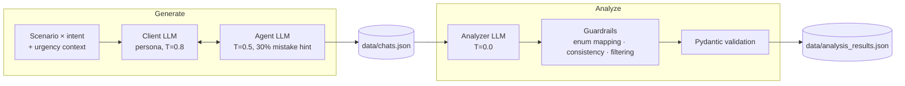

# Support Conversation Generator & Analyzer

> LLM pipeline built for the **SKELAR Case Challenge 2.0**. Part one **generates** realistic customer-support dialogues with controllable client personas and agent mistakes. Part two **analyzes** each dialogue: intent, satisfaction, hidden dissatisfaction (sarcasm, passive aggression), agent mistakes and a 1–5 quality score — with deterministic guardrails on top of the model.


📖 Detailed documentation (Ukrainian): [`project-documentation.md`](project-documentation.md) · [`README_ukr.md`](README_ukr.md)

---

## Pipeline



## Generation — controllable synthetic data

| Lever | How it's used |
|---|---|
| **5 intents** | `payment_problem`, `tech_error`, `account_access`, `tariff`, `refund` — 4 scenarios each |
| **4 personas** | `friendly`, `impatient`, `confused`, `hidden_dissatisfied` (outwardly polite, passive-aggressive) |
| **Urgency** | ~50% of dialogues get pressure context ("card declined at the checkout right now") |
| **Agent mistakes** | 30% of dialogues prompt the agent to slip: jargon, incomplete info, impatience |
| **Temperature split** | client 0.8 for emotional variety, agent 0.5 for stable replies |
| **Length** | 3–10 turns with random early exits; the dialogue always ends with the agent |

## Analysis — LLM + guardrails

Every dialogue is scored at `temperature=0.0` into a validated schema:

```json
{
  "conversation_id": 1,
  "intent": "payment_problem",
  "satisfaction": "hidden_dissatisfaction",
  "quality_score": 3,
  "agent_mistakes": ["incomplete_info", "tech_jargon"],
  "resolution_status": "partially_resolved",
  "hidden_dissatisfaction_score": 0.75,
  "key_action_items": ["Refund pending confirmation"],
  "agent_performance": "adequate",
  "detected_persona": "impatient"
}
```

Models are good at the hard part and sloppy at the boring part, so three deterministic guardrails fix the output after the LLM:

1. **Intent resolution** — unknown labels (`billing`, `login`, …) are mapped to the closest allowed intent.
2. **Consistency rule** — the model often detects sarcasm numerically (`hidden_dissatisfaction_score = 0.8`) but still labels the dialogue `neutral`. If the score is above **0.5**, the label is overridden to `hidden_dissatisfaction`.
3. **Mistake filtering** — invented mistake names (`bad_attitude`) are dropped; only the 8 allowed categories survive.

Pydantic then enforces ranges (`quality_score` 1–5, score 0–1).

## Reliability & speed

- **Async concurrency** with an `asyncio.Semaphore` (10 parallel requests by default) for both generation and analysis
- **Retries** on rate limits (429) with increasing back-off, then a fallback call
- Failed conversations are recorded in the output metadata instead of crashing the run

## Quick start

```bash
echo "OPENROUTER_API_KEY=your_key" > .env

docker compose build
docker compose run all        # generate + analyze
docker compose run generate   # generation only
docker compose run analyze    # analysis only (needs data/chats.json)
```

<details>
<summary>Run without Docker</summary>

```bash
pip install -r requirements.txt
PYTHONPATH=. python3 src/generate.py
PYTHONPATH=. python3 src/analyze.py
```

Windows (PowerShell): `$env:PYTHONPATH="."; python src/generate.py`
</details>

Settings — number of dialogues, turns, concurrency, model — live in [`src/config.py`](src/config.py).

## Next steps

- **Self-evaluation.** Generated dialogues already carry ground-truth labels (intent, persona, whether a mistake was injected). Comparing them with the analyzer's predictions gives accuracy per field — a built-in eval set
- Native structured outputs instead of parsing JSON from text
